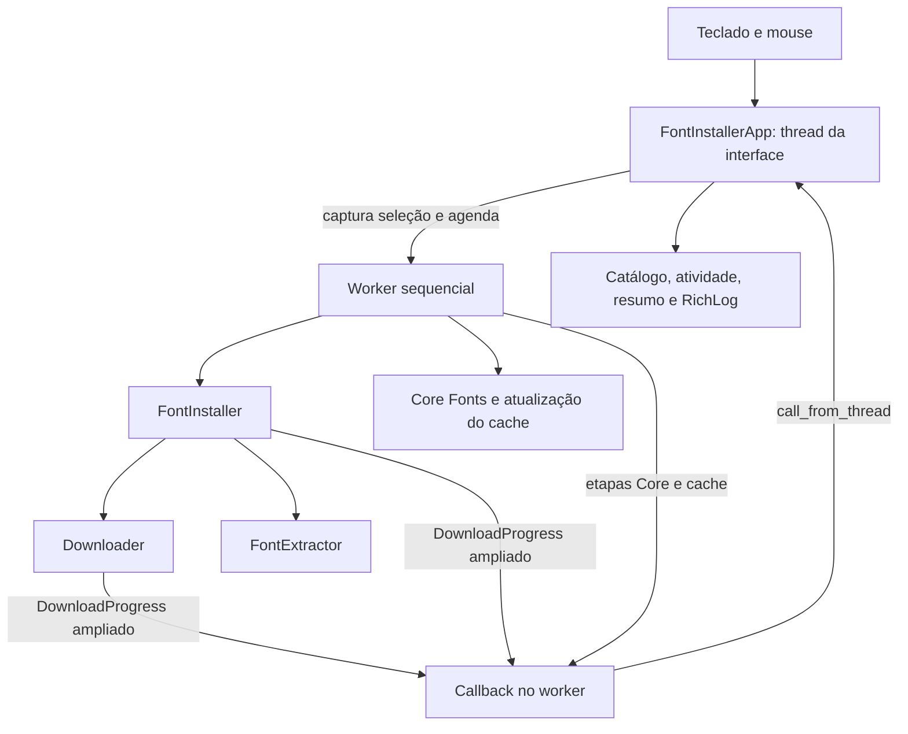

# Modernização da TUI do Font Installer

- **Autor:** usuário do projeto, com apoio do Codex.
- **Estado:** aprovado pelo usuário; design finalizado. Implementação não iniciada.
- **Data:** 2026-10-31.
- **Origem:** [conceito aprovado](./concepts_brief.md), seção “Conceito consolidado para aprovação”, que substitui as pendências históricas do brief.

## Visão geral

Modernizar a interface do instalador no terminal, preservando Textual e a
paleta Gruvbox Dark. A interface apresentará ClearType, Dev e Core Fonts na
mesma tela, sem abas, com seleção compacta, respostas visuais às ações e
acompanhamento da instalação por barra, spinners e logs em tempo real.

A composição aprovada tem duas colunas: sete opções Dev de um lado e os pacotes
Microsoft do outro. Os seis nomes ClearType ficam visíveis como conteúdo de um
único pacote. Logs ficam abaixo do catálogo em painel recolhível, aberto ao
iniciar cada instalação. A lista deverá caber sem rolagem no tamanho-alvo,
inclusive com progresso e logs abertos. Em terminais menores, será permitido
empilhar categorias e rolar o conteúdo.

## O problema

O usuário considera a apresentação atual antiga e quer mais movimento e
interatividade. Hoje, categorias estão separadas em abas e o catálogo disputa
altura com espaçamentos, descrições, progresso e logs. A aplicação já possui
barra de progresso, indicador de atividade e RichLog; a presença desses
componentes, por si só, não entrega a organização desejada.

Também há diferença entre baixar e concluir uma instalação: o percentual atual
chega a 100 antes da extração e cópia. O resumo da TUI pode anunciar conclusão
em verde mesmo após falhas individuais ou falha na atualização do cache.
Modernizar o acompanhamento exige comunicar essas situações com fidelidade,
além de mudar a apresentação.

A referência visual informada é uma tela HD 16:9. Resolução em pixels não
fixa o número de células do terminal. **120 colunas × 36 linhas** é o alvo
inicial aprovado para validação, não uma garantia de que toda configuração de
letra em uma tela HD terá esse espaço.

## Objetivos

1. Mostrar simultaneamente as nove unidades selecionáveis atuais: sete Dev,
   um pacote ClearType e um pacote Core. Exibir os seis nomes do catálogo
   ClearType sem criar seleção individual dessas famílias.
2. Em 120 × 36 células, manter nomes e controles do catálogo visíveis sem
   rolagem, com logs abertos, progresso ativo e aviso compacto de dependências.
   Validar esse orçamento antes de consolidar o layout final.
3. Abaixo do tamanho-alvo, permitir rolagem e reorganização das categorias,
   preservando seleção, foco e acesso a todos os controles.
4. Mostrar percentual do download atual apenas quando houver tamanho conhecido;
   nas demais esperas, usar spinner com nome de etapa. Mostrar também itens
   processados do lote, distinguindo sucesso e falha, sem estimativa artificial
   de duração.
5. Atualizar logs com início, mudança de etapa, resultado e erro. Manter até
   500 entradas em memória, sem registrar cada bloco de download. Permitir
   consultar histórico sem salto automático e retomar acompanhamento.
6. Abrir os logs ao iniciar cada lote e permitir recolhê-los durante a execução.
   Manter estado e resultado visíveis fora do painel, mesmo quando fechado.
7. Bloquear alterações da seleção e novos lotes durante a execução, mantendo
   navegação e consulta dos logs. Reabilitar os controles ao terminar.
8. Distinguir sucesso, falha parcial e falha no resumo, incluindo resultado do
   cache, sem confundir número de pacotes com número real de arquivos.
9. Preservar Gruvbox, português brasileiro e uso por teclado; tornar foco e
   estados perceptíveis também por texto. Manter movimentos discretos e leitura
   estável.
10. Preservar instalação sequencial, unidades instaláveis, destinos e
    gerenciadores atuais, bem como compatibilidade da CLI e callbacks usados
    por outros consumidores.

## Fora do escopo

- Interface gráfica ou web, troca de paleta ou ampliação do catálogo.
- Instalação independente de cada família ClearType ou instalação paralela.
- Cancelamento transacional, rollback de fontes ou pacotes e novos serviços.
- Persistência dos logs, exportação de diagnóstico ou captura integral da
  saída interativa de apt/sudo. Tempo real refere-se aos eventos da aplicação.
- Reescrita do instalador ou alteração da CLI sem necessidade para os objetivos.

## Questões técnicas em aberto

- Validar o orçamento de 120 × 36 células com todos os elementos simultâneos;
  a medida permanece condição a demonstrar, não resultado já testado.
- Resolvido pelo usuário: ampliar o callback atual com campos opcionais de
  etapa; manter os campos e a chamada já usados pela CLI.
- Resolvido pelo usuário: modal de licença e cópia verificada incluída no app.
  Preservar eventuais diálogos nativos do pacote no terminal suspenso; não
  registrar aceite automaticamente no debconf.
- Resolvido pelo usuário: confirmar intenção de sair, concluir o lote inteiro
  e somente então encerrar; não interromper o item atual nem pular os seguintes.
- Definir as APIs Textual compatíveis com a versão mínima declarada e os
  testes simulados necessários para verificar os estados de interface.

## Jornadas principais

### Escolher fontes e iniciar

- **Dado:** catálogo carregado e nenhuma instalação ativa.
- **Quando:** o usuário seleciona fontes por teclado ou mouse e aciona Instalar.
- **Então:** seleção vazia gera aviso fora dos logs; uma seleção válida é
  capturada como lote fixo. Antes de agendar o worker, a interface bloqueia
  edição e nova instalação, abre os logs e mostra o estado inicial.

### Acompanhar e consultar histórico

- **Dado:** lote em execução e painel de logs aberto.
- **Quando:** chegam eventos ou o usuário consulta registros anteriores.
- **Então:** etapa e progresso se atualizam sem mudar o foco. Consultar histórico
  pausa o acompanhamento automático. Recolher o painel não interrompe o lote;
  a faixa de atividade permanece visível. Retomar acompanhamento é explícito.

### Terminar com resultado verificável

- **Dado:** lote com resultados de itens e resultado do cache.
- **Quando:** a execução termina, inclusive por erro inesperado.
- **Então:** animações param, controles são reabilitados e um resumo persistente
  distingue sucesso, falha parcial e falha. Logs continuam disponíveis.

### Redimensionar

- **Dado:** seleção ou lote ativo.
- **Quando:** o terminal fica menor que o alvo.
- **Então:** categorias podem ser empilhadas e o catálogo pode rolar; seleção,
  histórico e lote permanecem os mesmos. Voltar ao tamanho-alvo restaura as
  colunas sem reconstruir o estado de instalação.

## Plano técnico

### Limites dos componentes

A aplicação continua sendo um processo local, com um worker de instalação
sequencial. `ui/app.py` mantém seleção, lote e apresentação; `ui/styles.py`
centraliza layout e Gruvbox. `core/installer.py` continua orquestrando instalação,
`core/downloader.py` mantém download e o contrato de callback. Não haverá
barramento de eventos, serviço externo ou persistência nova.

O callback é síncrono na thread emissora; apenas a atualização dos widgets é
encaminhada à thread da interface. Nenhum subprocesso atualiza widgets.
O worker pode comunicar início e fim de Core/cache pelo mesmo receptor da
TUI sem transformar os métodos estáticos existentes em métodos de instância.

### Contrato de eventos: decisão do usuário

Foi escolhida a ampliação de `DownloadProgress`, em vez de um segundo callback.
A chamada continua aceitando um único objeto. Preservar a ordem e os tipos dos
cinco campos atuais: `name`, `percent`, `status`, `bytes_downloaded` e
`total_bytes`. Acrescentar ao final campos opcionais com padrões compatíveis:

| Campo novo | Conteúdo | Padrão para chamadas antigas |
| --- | --- | --- |
| `phase` | Identificador: `lookup`, `download`, `extract`, `copy`, `package` ou `cache` | `None` |
| `event` | `started`, `progress`, `completed` ou `failed` | `None` |

Os identificadores não são traduzidos; `status` continua sendo texto legível.
Não inferir fase buscando palavras em `status`. Um evento antigo sem fase
atualiza a descrição, mas não autoriza percentual de instalação global.
A CLI que lê `name` e `status` continua funcionando sem adaptação obrigatória.
Não mudar `percent` para opcional: a TUI decide se deve exibi-lo usando fase e
tamanho conhecido, sem alterar a interpretação do valor para consumidores antigos.

Em download, `total_bytes > 0` permite percentual. Com total desconhecido,
manter spinner e informar os bytes recebidos quando disponíveis. O evento de
fim do download pode preservar `percent=100` para compatibilidade, mas não
conclui o item: extração e cópia continuam como fases próprias sem percentual.
Consulta, extração e cópia emitem início/fim ou falha no mesmo callback.
A TUI conta um item somente após o retorno do método instalador.

### Estado de execução e resultados

A thread da interface é dona do estado apresentado: livre ou executando,
seleção capturada, item atual, etapa atual, itens processados, resultados,
estado do cache e preferência de acompanhamento dos logs. O worker recebe
uma cópia da seleção; não consulta checkboxes durante a execução.

A guarda de execução é ativada antes de agendar o worker. Os handlers de
atalhos também respeitam essa guarda; desabilitar apenas o botão não basta.
Falha no agendamento precisa liberar a guarda e apresentar erro. O encerramento
normal ou excepcional centraliza a liberação em uma atualização final da UI.

Preservar a ordem atual: ClearType, Dev na ordem do catálogo, Core, cache.
Falhas retornadas por um item são registradas e não impedem tentar o próximo.
Exceção inesperada interrompe o restante do lote e marca itens não tentados.
O cache é uma operação separada, sem aumentar o total de fontes selecionadas.
Seu retorno falso ou exceção aparece no resumo e nunca como cache atualizado.

Para downloads/copias, registrar sucesso apenas se todos os arquivos extraídos
forem copiados. Se nenhuma cópia funcionar, o item falha; se apenas parte
funcionar, o item tem falha parcial e informa a contagem copiada. É possível
comparar a quantidade extraída com a copiada sem alterar o retorno inteiro do
helper privado. Ampliar `InstallResult` com um campo opcional de quantidade
esperada permite à TUI distinguir esses casos preservando os quatro argumentos
atuais; `success` é falso se a cópia não foi completa. Os testes deverão cobrir
colisões e contagens como operações de cópia, sem prometer arquivos únicos.

Core mantém o retorno atual para consumidores existentes; seu valor histórico
`files_installed=1` não será somado a arquivos na TUI. O resumo informa resultado
do pacote e deixa a contagem real de arquivos Core como não medida.

| Resultado agregado | Condição |
| --- | --- |
| Sucesso | Todos os itens completos e cache atualizado |
| Falha parcial | Há itens completos ou cópias realizadas, mas algum item, etapa ou cache falhou |
| Falha | Nenhum item completo nem cópia realizada, com falhas ou interrupção |

O resultado final é distinto de itens processados. Não adicionar pesos de
progresso temporal nem barras que avancem sozinhas durante espera.

### Layout e orçamento de altura

Usar os componentes existentes e retirar o contêiner de abas. No alvo, o
catálogo ocupa duas colunas: Dev à esquerda, Microsoft à direita. Nomes
ClearType são distribuídos em linhas curtas; descrições extensas e diretórios
ficam em ajuda acessível, sem disputar o espaço básico do catálogo.

Orçamento inicial para 36 linhas, incluindo bordas e espaçamentos:

| Região | Linhas máximas reservadas |
| --- | ---: |
| Cabeçalho, instrução curta e dependências | 4 |
| Catálogo em duas colunas | 14 |
| Atividade, contador e progresso | 4 |
| Logs abertos, incluindo cabeçalho | 8 |
| Ações e rodapé | 4 |
| Reserva para ajustes | 2 |

Não usar margem vertical de uma linha em cada opção. O catálogo deve conter
os sete nomes Dev, seis nomes ClearType e a identificação Core sem corte.
O aviso compacto de dependências ocupa a região reservada; detalhes ficam
nos logs ou ajuda, sem crescer indefinidamente na tela principal.

Abaixo de 120 colunas ou 36 linhas, permitir o modo compacto com catálogo
empilhado e rolável. Progresso e controles permanecem acessíveis; nos tamanhos
muito pequenos, priorizar acesso por rolagem sobre visibilidade simultânea.
O alvo será demonstrado por teste de geometria e inspeção visual, inclusive
com mensagens de erro. Não é resultado já verificado nesta etapa documental.

### Logs, movimento e teclado

Manter histórico lógico de até 500 entradas em memória. Como uma entrada pode
ocupar várias linhas, não tratar `RichLog.max_lines=500` como equivalência
automática a 500 eventos. Aplicar retenção no histórico e limitar também a
renderização; remover as entradas mais antigas ao atingir o limite.

Deduplicar transições pelo par item/etapa e tipo de evento. Eventos de progresso
atualizam a barra, sem gerar uma linha por bloco. Ao ler histórico, manter
acompanhamento pausado até ação explícita. Registrar textos de erro como texto
literal, sem permitir que nomes ou mensagens externas sejam interpretados como
marcação Rich.

Preservar `a` para selecionar ClearType/Dev, com rótulo de alcance explícito;
Core continua escolha individual. `c` limpa seleção apenas fora da execução;
`i` inicia e `q` solicita saída. Disponibilizar ações identificadas de abrir ou
recolher logs, seguir o final e consultar ajuda. Detalhar teclas novas na etapa
de implementação sem sobrepor navegação padrão dos widgets.

O atalho atual `r` não apaga o histórico durante uma instalação. Fora dela,
pode manter limpeza de logs e nova verificação de dependências, com descrição
explícita. O resumo final permanece independente da limpeza do histórico.

Usar spinner somente enquanto houver trabalho; encerrá-lo em todos os caminhos
finais. Seleção altera contador e estado dos controles imediatamente, sem mover
foco. Evitar transições que mudem a altura continuamente ou tornem nomes
ilegíveis. Animação não deve esconder ausência de progresso real.

### Compatibilidade, validação e pendências

Não acrescentar dependência de animação ou de logs. Verificar a implementação
na faixa Textual declarada antes de assumir APIs observadas no ambiente atual;
o pacote instalado não comprova compatibilidade com a versão mínima.
Qualquer necessidade de elevar a versão mínima será decisão explícita.

Testes simulados deverão verificar construtores antigos dos eventos, sequências
de etapas, download sem tamanho, cópia parcial, cache falhando, execução única,
logs recolhidos, consulta ao histórico e redimensionamento. Não executar apt,
sudo ou downloads reais para testar o layout.

### Modal de licença de Core Fonts: solicitação do usuário

Se Core Fonts estiver selecionado, a ação Instalar abre uma tela modal com
aviso sobre a licença, texto consultável e ações “Aceitar e continuar” e
“Não aceitar”. Não iniciar o worker nem executar gerenciador de pacotes antes
do aceite. O foco inicial fica na recusa; Escape ou fechamento equivalem a não
aceitar. O texto pode rolar dentro do modal, independentemente da regra de
visibilidade do catálogo principal.

A recusa encerra essa tentativa de iniciar o lote e retorna à seleção sem
instalar nada. A seleção permanece editável para retirar Core ou tentar
novamente. Não remover Core silenciosamente nem iniciar um lote diferente do
confirmado. O aceite vale para o lote confirmado, sem checkbox previamente
marcado nem gravação permanente de consentimento pelo app.

Exibir o texto efetivo aplicável ao pacote selecionado, sem inventar termos ou
substituir o texto por um resumo. A origem e a versão desse texto devem ser
verificadas no pacote/documentação correspondente antes da implementação.
Se não for possível carregar a licença, informar indisponibilidade e impedir
a confirmação de Core, mantendo o restante do catálogo acessível ao retornar.
A integração do aceite com o mecanismo do pacote ainda precisa ser verificada;
fechar o modal com aceite não garante que o pacote deixe de solicitar licença
em seu próprio fluxo. Não gravar configuração de aceite no sistema nesta fase
de desenho.

Depois do aceite, validar novamente o estado livre, capturar o lote e bloquear
a edição antes de agendar o worker. A pré-confirmação também deve impedir
modais duplicados ao pressionar Instalar repetidamente. Se a execução terminar,
restaurar a seleção e as regras normais de foco.

### Autenticação nativa com a TUI suspensa: decisão do usuário

O usuário escolheu suspender temporariamente a TUI e usar o prompt nativo do
terminal quando a instalação Core precisar de interação. Não coletar senha em
widgets, argumentos de comando ou logs. O modal de licença continua sendo
apresentado antes de iniciar o lote.

A região suspensa deve abranger a execução completa do gerenciador de pacotes,
não apenas `sudo -v`: o pacote também pode emitir saída ou pedir confirmação.
Preservar stdin/stdout/stderr nativos durante essa região. O mecanismo de
suspensão/restauração deve ser verificado na versão Textual suportada, incluindo
sua interação com o worker; não manipular o terminal por duas threads ao mesmo
tempo. Os demais itens do lote continuam sequenciais.

Antes de suspender, mostrar que Core será executado no terminal. Ao retornar,
restaurar a TUI, preservar seleção e histórico e acrescentar o resultado da
operação. Durante a suspensão, os spinners e logs visuais ficam pausados; o
terminal mostra a saída nativa. Não prometer logs em tempo real na TUI enquanto
a própria TUI estiver suspensa. Retorno não zero, senha recusada ou interrupção
nessa operação precisam produzir resultado de falha, sem encerrar silenciosamente
o aplicativo. Restaurar a apresentação em bloco de finalização, inclusive em
erros. Não adicionar repetição automática de comandos privilegiados.

A captura integral da saída nativa permanece fora do escopo. O aceite da licença
no modal precisa ser integrado ao pacote por mecanismo comprovado; caso ele
mostre seu próprio diálogo, esse fluxo fica acessível no terminal suspenso.
A suspensão não altera a restrição de Core à família Debian/apt.

### Saída adiada até o término do lote: decisão do usuário

Quando `q` ou a ação de saída forem acionados com lote ativo, mostrar confirmação
com “Concluir lote e sair” e “Continuar no aplicativo”. Confirmar ativa uma
intenção de saída; não cancela o worker, não pula itens e não interrompe apt.
Manter estado “Saída após concluir o lote” na faixa da interface. Uma nova
solicitação enquanto essa intenção estiver ativa não agenda outra saída.

Ao finalizar o lote, registrar o resumo e executar a restauração final da UI
antes de encerrar. Se houver falha inesperada que encerre o lote antecipadamente,
concluir o tratamento de erro e só então sair. Não iniciar novos itens depois
dessa finalização. O comportamento refere-se à saída normal oferecida pelo app;
sinais do sistema e fechamento forçado do terminal não são cancelamento seguro.
Durante a suspensão para Core, o terminal nativo controla a entrada e `q` não
atua como atalho da TUI.

A origem do texto será registrada no recurso empacotado, conforme a escolha
do usuário por cópia local. O aceite do modal libera o lote no app; o pacote
continua responsável por seus próprios diálogos no terminal suspenso. Não
suprimir esses diálogos nem gravar aceite no debconf. Isso evita presumir uma
chave comum entre variantes Debian e Ubuntu. O plano abaixo detalha espera e
validação; a compatibilidade das APIs e o texto empacotado são verificações
obrigatórias antes da entrega da implementação.

### Evidência adicional sobre variantes de Core Fonts

Na inspeção do fonte Debian `msttcorefonts` 3.8.1, o arquivo de templates contém
configurações de download, mas não o template de aceite que aparece em outras
variantes. Isso impede tratar uma chave de consentimento como universal.
O modal solicitado permanece; a origem do texto e a integração por variante
precisam ser especificadas antes da execução.

Fonte consultada: [templates Debian 3.8.1](https://sources.debian.org/src/msttcorefonts/3.8.1/debian/templates).

## Alternativas consideradas

As alternativas de apresentação e progresso foram extraídas do
[brief aprovado](./concepts_brief.md). As decisões sobre callback, licença e
sudo foram tomadas durante a elaboração deste desenho.

| Alternativa | Benefício | Custo ou limitação | Decisão e motivo |
| --- | --- | --- | --- |
| Aplicativo com janela própria | Layout controlado em pixels | Mudaria o ambiente de uso | Descartado: o usuário escolheu TUI |
| Trocar a paleta | Outra direção estética | Abandona a identidade atual | Descartado: o usuário pediu manter Gruvbox |
| Categorias em abas | Reduz espaço exigido por tela | Esconde as demais categorias | Descartado: todas devem aparecer simultaneamente |
| Lista única agrupada | Funciona com menor largura | Usa mais altura com logs abertos | Não escolhida como layout principal; duas colunas aproveitam o alvo de 120 × 36; empilhamento permanece como adaptação para terminais menores |
| Duas colunas compactas | Mostra Dev e pacotes Microsoft simultaneamente | Precisa de largura mínima e descrições curtas | Escolhida no conceito aprovado, sujeita à validação de geometria |
| Logs sempre abertos | Histórico imediatamente visível | Ocupa altura mesmo sem instalação | Descartado como regra permanente; painel recolhível foi aprovado |
| Logs recolhíveis e faixa de atividade | Libera espaço sem esconder o estado atual | Requer indicação fora do painel | Escolhido: abre no início do lote e pode ser recolhido pelo usuário |
| Percentual global com pesos de etapas | Uma barra aparentemente contínua | Não existe medida confiável de duração por etapa | Descartado: poderia aparentar conclusão enquanto ainda há trabalho |
| Percentual do download, contador e spinner | Usa medidas reais e identifica esperas | Exige rótulos que distingam download, item e lote | Escolhido: não promete percentual global ou tempo restante |
| Segundo callback exclusivo de etapas | Separa contratos de download e instalação | Exige coordenar dois fluxos | Não escolhido pelo usuário; ele optou por ampliar o callback atual |
| Campos opcionais no callback atual | Preserva consumidores e um fluxo de eventos | O nome DownloadProgress passa a abranger mais etapas | Escolhido pelo usuário; manter construtores antigos e campos atuais |
| Apenas diálogo nativo da licença | Reaproveita interação do pacote | Não oferece o aviso e aceite dentro da TUI | Insuficiente para o pedido: modal da aplicação deve preceder a instalação; eventual diálogo do pacote permanece acessível no terminal |
| Autenticar sudo antes do lote | Evita a primeira solicitação de senha dentro da execução | Não garante ausência de novos prompts ou diálogo do pacote | Não escolhida: o usuário preferiu suspensão durante a interação nativa |
| Suspender a TUI durante Core Fonts | Permite senha e diálogos no terminal nativo | Pausa acompanhamento visual e exige restauração em erros | Escolhida pelo usuário; o resultado retorna ao histórico da TUI |

A lista não estabelece novas dependências nem autoriza mudanças de escopo.
As decisões posteriores sobre saída adiada e cópia local da licença estão
registradas no plano de implementação. A confirmação nativa do pacote permanece
acessível; não foi escolhida integração automática de aceite ao debconf.

## Implementação detalhada

### Cópia local da licença: decisão do usuário

Incluir o texto verificado como recurso do pacote Python, carregado por
`importlib.resources`, sem download para abrir o modal. Registrar junto dele
origem, data de obtenção, identificação do documento e SHA-256 do texto incluído.
Uma fonte identificada para conferência é a
[EULA publicada no projeto Core Fonts](https://corefonts.sourceforge.net/eula.htm).
Isso identifica a fonte; não constitui conferência já realizada do recurso,
que será criado durante a implementação. Não traduzir, resumir nem preencher
termos ausentes. A interface ao redor permanece em pt-BR.

Antes de distribuir, comparar o recurso com o texto de referência e com a
licença que acompanha os instaladores suportados. Se houver diferença material,
voltar ao desenho em vez de assumir equivalência. Falha de leitura ou integridade
do recurso bloqueia apenas a tentativa de iniciar lote com Core selecionado,
com mensagem para retornar e desmarcá-lo. O recurso precisa estar no wheel e na
instalação resultante; funcionar somente na árvore fonte não satisfaz o aceite.

Não copiar os binários de fontes para o repositório. O app não persiste o aceite;
se o pacote pedir confirmação própria durante a suspensão, o usuário responde
nesse fluxo. O modal deve avisar que pode existir confirmação adicional.

### Política de espera e suspensão

Reutilizar `Settings.API_TIMEOUT=30` para consulta de release e
`Settings.DOWNLOAD_TIMEOUT=300` como limite de espera de rede no download.
Esses valores limitam operações de rede, não a duração total do lote; manter
mensagem de etapa e tempo decorrido, sem anunciar ETA. Não configurar timeout
global de socket nem matar apt por tempo decorrido. Comandos interativos Core
ficam sob controle do terminal nativo, sem repetição automática ou limite que
possa interromper configuração de pacotes.

Substituir internamente `urlretrieve` por leitura em blocos com `urlopen`
para aplicar timeout por operação de rede, medir bytes e tratar tamanho ausente.
Preservar a API `download_file(url, dest, name)` e o contrato de erros. Falha HTTP,
rede ou JSON da consulta de release deve produzir diagnóstico identificável;
`None` continua significando ausência de asset compatível. O instalador converte
falhas de consulta em resultado do item, sem abortar os demais por erro esperado.

Operações locais de extração e cópia não recebem cancelamento novo. A saída
adiada aguarda o fim real da operação; não prometer encerramento em prazo fixo.

Executar a entrada e saída do contexto público `App.suspend()` sob controle
da thread da interface. O worker solicita a execução da etapa Core por uma
ponte síncrona para um handler da UI; esse handler suspende a TUI e executa a
chamada bloqueante de Core com terminal nativo. A UI fica intencionalmente
pausada nessa etapa, e o worker não executa itens em paralelo. Capturar erros e
interrupção dentro da região suspensa, convertendo-os em resultado antes de sair
do contexto para que a restauração normal ocorra. A ponte não chama o receptor
que usa `call_from_thread` recursivamente a partir da thread da interface.

Se suspensão não for suportada, registrar falha do item Core e seguir o fluxo
de finalização; não executar apt com o terminal ainda capturado. A CLI mantém
sua execução nativa e não passa por essa ponte. Verificar suporte na versão
mínima declarada; não alterar versão mínima sem nova decisão explícita.

### Lista única de execução por arquivo

Todos os caminhos abaixo são relativos à raiz do projeto. Arquivos indicados
como novos ainda não existem; a lista é plano, não relato de alterações feitas.
Nenhum arquivo será excluído. Preservar as alterações locais anteriores do usuário.

| Ordem | Arquivo e ação | Alteração e motivo |
| --- | --- | --- |
| 1 | `src/font_installer/core/downloader.py` — modificar | Acrescentar `phase` e `event` opcionais ao final de DownloadProgress, mantendo os cinco campos antigos; emitir transições e progresso de download. Usar streaming com timeout existente e contagem de bytes; diferenciar falhas de release de ausência de asset para diagnóstico fiel. |
| 2 | `src/font_installer/core/installer.py` — modificar | Emitir fases de consulta, extração e cópia; converter erros esperados em InstallResult. Acrescentar `files_expected: int | None = None` ao final do resultado e marcar sucesso somente em cópia completa e não vazia. Preservar assinatura dos métodos estáticos Core/cache. |
| 3 | `src/font_installer/ui/assets/core-fonts-eula.txt` — criar | Incluir o texto integral conferido para o modal, sem busca de rede em execução. |
| 4 | `src/font_installer/ui/assets/README.md` — criar | Registrar fonte, identificação, data de conferência, hash e procedimento de atualização do texto. Declarar que a licença das fontes não é a licença MIT do app. |
| 5 | `src/font_installer/ui/screens/license.py` — criar | Definir CoreFontsLicenseScreen como modal com leitura rolável, aviso de confirmação nativa adicional, aceite e recusa; foco inicial na recusa, Escape recusa e retorno booleano. Carregar recurso empacotado com importlib.resources. |
| 6 | `src/font_installer/ui/screens/confirm_exit.py` — criar | Definir confirmação de concluir lote e sair, sem acionar cancelamento; retorno booleano para a intenção de saída. |
| 7 | `src/font_installer/ui/screens/help.py` — criar | Manter diretórios, descrições e ajuda que saem da antiga aba Info; modal de consulta, sem modificar seleção ou lote. |
| 8 | `src/font_installer/ui/app.py` — modificar | Substituir abas por catálogo compacto; manter IDs existentes de seleção; controlar pré-confirmação, execução única, cópia fixa do lote, resultados e saída adiada. Integrar modais, suspensão nativa de Core, faixa de atividade e histórico limitado com acompanhamento pausável. |
| 9 | `src/font_installer/ui/styles.py` — modificar | Aplicar orçamento 120 × 36, duas colunas, empilhamento compacto, foco perceptível e estilos dos modais. Preservar paleta e LOG_COLORS; limitar animações aos indicadores de atividade. |
| 10 | `src/font_installer/cli.py` — modificar | Corrigir ajuda de atalhos e alcance de selecionar ClearType/Dev; preservar comandos e consumo dos campos antigos. Não redirecionar CLI para modais ou suspensão da TUI. |
| 11 | `pyproject.toml` — modificar | Explicitar inclusão dos recursos de licença no wheel/sdist. Preservar dependência Textual declarada; novos testes assíncronos usam asyncio.run e o harness nativo, sem exigir plugin adicional. |
| 12 | `tests/test_downloader.py` — criar | Cobrir streaming conhecido/desconhecido, eventos, timeout e erros de release, sem rede. Verificar construtores antigos de DownloadProgress. |
| 13 | `tests/test_installer.py` — modificar | Acrescentar cenários com arquivos temporários para cópia completa, parcial e zero; fases de extração/cópia e erro de consulta; manter testes existentes. |
| 14 | `tests/test_ui.py` — criar | Exercitar App.run_test com instalador simulado, resultados, guarda de execução, logs, atalhos, saída adiada e geometria em 120 × 36 e 80 × 24; verificar redimensionamento de ida e volta. |
| 15 | `tests/test_ui_screens.py` — criar | Testar modal de licença, recusa/Escape, foco, aceite, recurso ausente e confirmação de saída. Simular suspensão/apt e provar restauração em sucesso, falha e interrupção. |
| 16 | `tests/test_cli.py` — criar | Confirmar ajuda atualizada, comandos existentes e callback legado sem invocar instalações reais. |
| 17 | `DESIGN.md` — modificar | Substituir a orientação antiga de preservar layout por visão simultânea, orçamento em células, feedback e regras aprovadas; manter Gruvbox. |
| 18 | `README.md` — modificar | Atualizar estrutura, representação da interface, atalhos, logs, licença e suspensão Core; preservar instalação e notas existentes. |
| 19 | `src/README.md` — modificar | Atualizar limites resumidos para refletir catálogo simultâneo e modais, mantendo links resolvíveis. |
| 20 | `src/font_installer/README.md` — modificar | Atualizar interface TUI e efeitos da confirmação/suspensão, preservando contrato da CLI. |
| 21 | `src/font_installer/core/README.md` — modificar | Documentar callback ampliado, streaming, semântica de resultado parcial e diagnóstico. |
| 22 | `src/font_installer/ui/README.md` — modificar | Documentar catálogo, estados, logs, modais e suspensão nativa; retirar afirmação de que screens é apenas placeholder. |
| 23 | `src/font_installer/ui/screens/README.md` — modificar | Documentar os três modais e seus retornos, invariantes de foco e efeitos de confirmação. |

`core/packages.py` mantém os comandos e a seleção de gerenciador existentes;
a ponte de suspensão fica na TUI. `config/fonts.py`, `config/settings.py`,
`ui/screens/__init__.py` e `ui/widgets/` não precisam de alteração no plano.
Importar telas diretamente de seus módulos evita exportações novas sem uso.
Os testes existentes de pacotes continuam como regressão. Não atualizar lockfile
apenas por incluir recursos, pois não há mudança planejada de dependência.

### Comportamento que a implementação deve demonstrar

- Atalhos: `a` seleciona ClearType/Dev; `c` limpa seleção; `i` instala;
  `l` abre/recolhe logs; `f` retoma acompanhamento; `?` abre ajuda; `r` limpa
  logs e verifica dependências apenas fora da execução; `q` usa saída adiada
  quando necessário. Preservar Tab, Shift+Tab, Espaço e Enter dos widgets.
- Estado de pré-confirmação impede duplo modal e duplo worker. Recusa não inicia
  nenhum item e devolve foco ao controle que abriu o modal. Aceite conserva o
  lote confirmado, não uma seleção alterada por trás do modal.
- Seleção tem contador visível e feedback imediato. Aviso de seleção vazia,
  dependências e resumo final ficam legíveis com logs recolhidos.
- Guardar até 500 entradas, normalizadas em uma linha lógica e com comprimento
  máximo de 2.048 caracteres por entrada; detalhes extensos são truncados com
  indicação. Renderizar RichLog sem wrap no painel, com até 500 linhas, evitando
  divergência entre limite lógico e visual. Não interpretar conteúdo externo
  como markup. Pausar acompanhamento por comandos de rolagem do histórico e
  retomá-lo apenas pela ação Seguir.
- Eventos de download não precisam produzir um repaint por bloco: consolidar
  progresso para no máximo dez atualizações por segundo, preservando a última
  amostra; transições e erros nunca são descartados. Não bloquear a thread de
  rede para esperar animação.
- Eventos sem fase mantêm descrição e não produzem classificação por palavras.
  Trocar item ou fase limpa medida anterior; spinner e percentual não anunciam
  simultaneamente estados contraditórios.
- O worker captura o identificador do lote na entrega de eventos; ignorar
  mensagens atrasadas depois da finalização para não reativar animação antiga.
- Falhas retornadas permitem próximos itens; exceção inesperada encerra o lote
  com itens não tentados. Cache falso ou ausente é falha explícita. Core não
  acrescenta uma contagem fictícia ao total de arquivos.
- Confirmação de saída marca intenção; concluir todos os itens e cache antes
  da saída normal. Não matar subprocessos ou adicionar cancelamento implícito.

### Verificação planejada

Esta seção define verificações futuras; nenhum teste de implementação foi
executado nesta etapa de redação.

1. Executar `.venv/bin/python -m pytest -m "not integration"` na raiz, incluindo
   cenários simulados novos. Nada nessa suíte deve usar sudo, apt ou rede reais.
2. Verificar geometria: todas as nove opções, os seis nomes ClearType, atividade,
   aviso compacto e log aberto dentro de 120 × 36. Em 80 × 24, comprovar acesso
   por rolagem e foco, sem exigir visibilidade simultânea.
3. Inspecionar renderizações dos estados livre, ocupado, falha parcial, logs
   recolhidos, modal de licença e modal de saída. Registrar como evidência da
   implementação, sem transformar snapshots no único teste de comportamento.
4. Validar a API escolhida no Textual mínimo declarado e no ambiente atual
   (8.2.8 observado nesta sessão). Se a versão mínima não suportar o fluxo,
   parar para decisão explícita antes de alterar a dependência.
5. Gerar wheel/sdist em diretório temporário; listar o conteúdo e abrir o texto
   da licença a partir de uma instalação isolada desse wheel, fora da árvore.
   Confirmar metadados de origem e hash, sem baixar fontes.
6. Rodar lint dos arquivos alterados com Ruff no ambiente de desenvolvimento,
   quando instalado, distinguindo problemas anteriores das alterações atuais.
7. Conferir todos os links locais de documentação após a implementação.
8. Validar manualmente suspensão e retorno com programa simulado no terminal.
   Uma instalação real de Core requer ambiente Debian/Ubuntu de teste separado,
   com consentimento explícito para instalação de pacotes; não usar o host de
   desenvolvimento para provar comportamento visual.

### Condições para concluir a implementação

Entregar todos os critérios de comportamento acima e evidências do orçamento
visual, compatibilidade e recurso empacotado. A licença deve ter texto e hash
reais, sem placeholder. A suspensão deve restaurar o terminal em todos os
caminhos testados. Pendências encontradas nesses experimentos precisam voltar
ao desenho; não substituir silenciosamente layout, dependência ou fluxo aprovado.

## Registro de aprovação

- Visão geral, problema e objetivos: aprovados pelo usuário.
- Ampliação do callback atual com campos opcionais: escolhida pelo usuário.
- Modal de aviso e aceite da licença Core Fonts: solicitado pelo usuário;
  regras de recusa e integração descritas para revisão.
- Suspensão temporária da TUI para prompt nativo de sudo: escolhida pelo usuário.
- Plano técnico, incluindo modal e suspensão nativa: aprovado pelo usuário.
- Alternativas consideradas: aprovadas pelo usuário.
- Saída após concluir o lote inteiro: escolhida pelo usuário.
- Cópia verificada da licença incluída no app: escolhida pelo usuário.
- Implementação detalhada: aprovada pelo usuário.

## Conferência com o conceito aprovado

Não foram identificadas contradições com o conceito consolidado do brief.
As adições que afetam contratos ou interação foram aprovadas durante o desenho:
callback ampliado, resultado com quantidade esperada, modais de licença/saída,
cópia local da licença e suspensão nativa de Core. O fluxo de saída conclui o
lote antes de encerrar. Nenhuma dependência nova ou elevação da versão mínima
foi aprovada. Validação visual e compatibilidade continuam critérios da futura
implementação, não evidências já produzidas.

*Documento elaborado com EGM.*
